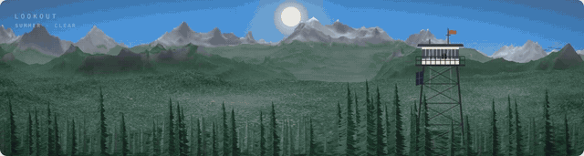
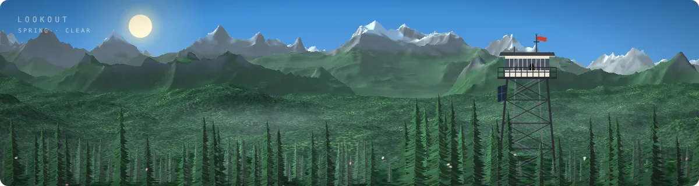
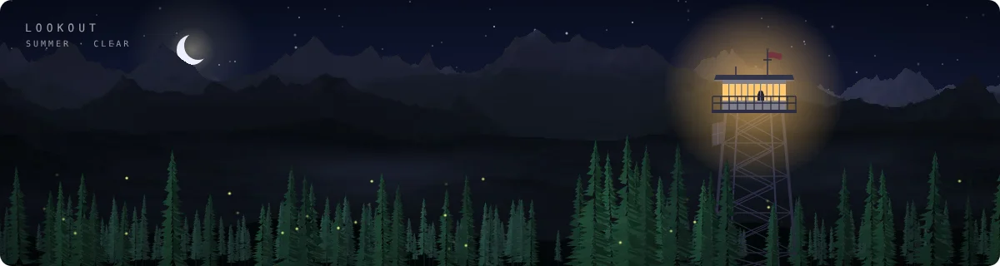
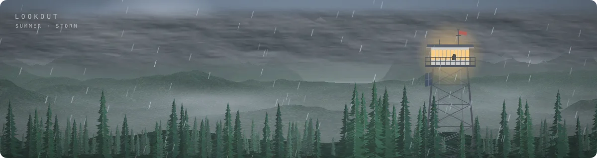
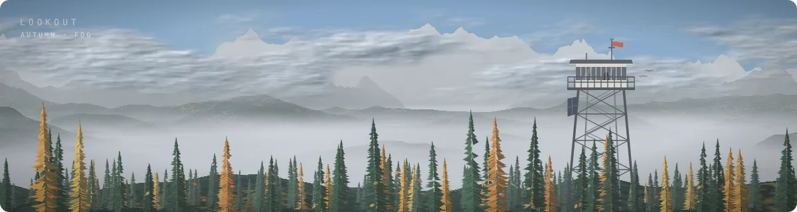
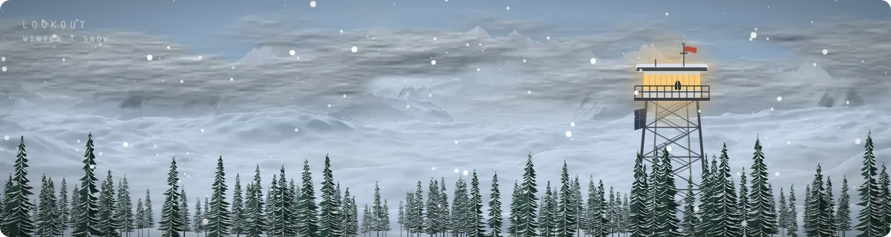
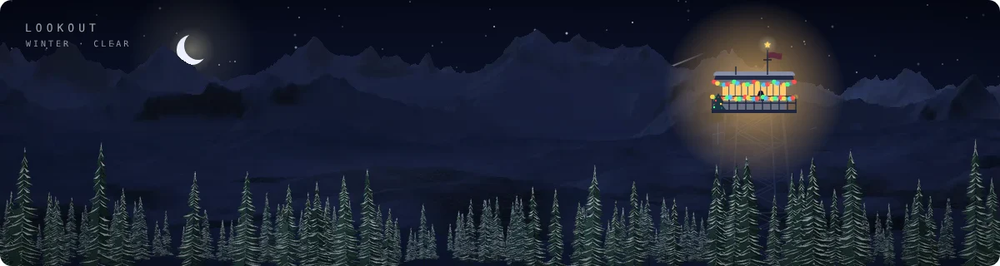
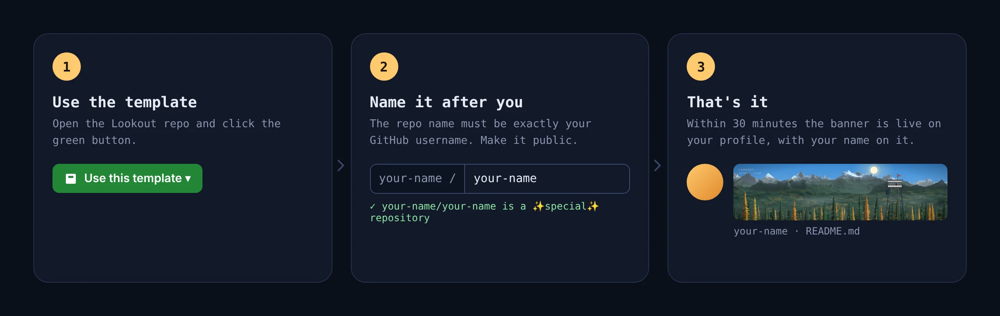
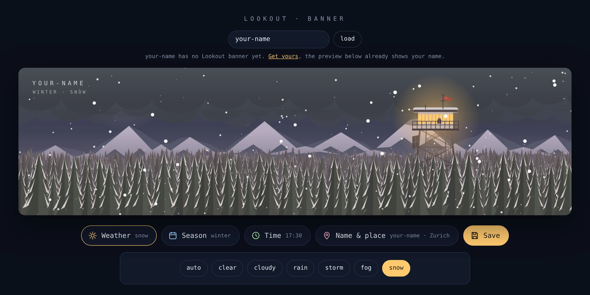
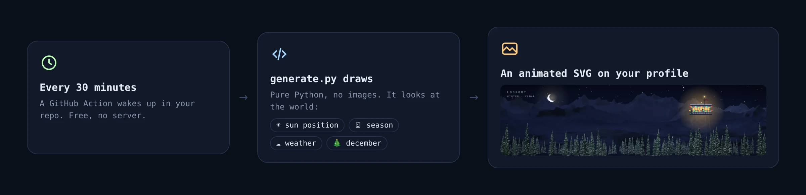

<!-- lookout:product (this line is replaced automatically when you use the template) -->

<h1 align="center">🌲 Lookout</h1>

<p align="center"><b>A living banner for your GitHub profile.</b><br>
A fire lookout above a sea of treetops that follows the real season, weather and time of day.</p>

<p align="center">
  <a href="https://github.com/new?template_name=lookout-banner&template_owner=Flaco2009"><b>➜ Get your own</b></a> ·
  <a href="https://flaco2009.github.io/lookout-banner/">Try the playground</a> ·
  <a href="https://github.com/Flaco2009">See it live</a>
</p>

<a href="https://flaco2009.github.io/lookout-banner/"></a>

<p align="center"><sub>☝️ This is live. It changes while you read this.</sub></p>

<p align="center"><br>
<sub>Noon · dusk · night · thunderstorm · autumn · snowfall · December</sub></p>

## ✨ What it does

| | |
|---|---|
| 🕐 **Time of day** | Sun and moon follow the real sun position at your place. Dusk turns the sky pink, at night the stars come out, the ranger switches on the lights and shooting stars fly by. |
| 🗓 **Seasons** | Spring blossoms, summer fireflies, autumn larches turn gold and drop their leaves, winter buries everything in snow. Switches by date, automatically. |
| ☁️ **Weather** | Random and season-aware, changes every 3 hours: clear, cloudy, rain, thunderstorm with real branching lightning, fog, snow. Wind makes the trees sway. |
| 🎄 **December** | String lights on the tower, a tiny tree on the catwalk and a star on the antenna. |
| 🎛 **Your call** | Pin any weather, season or time on your profile for an hour, a week or forever, then reset to auto. |

## 🖼 Gallery

<table>
<tr>
<td><br><sub>Spring morning</sub></td>
<td><br><sub>Summer night</sub></td>
</tr>
<tr>
<td><br><sub>Thunderstorm</sub></td>
<td><br><sub>Autumn fog</sub></td>
</tr>
<tr>
<td><br><sub>Snowfall</sub></td>
<td><br><sub>December night</sub></td>
</tr>
</table>

## 🚀 Get your own in 1 minute



1. Click **[Use this template → Create a new repository](https://github.com/new?template_name=lookout-banner&template_owner=Flaco2009)**
2. Name the repo **exactly like your GitHub username** (e.g. `octocat/octocat`) and keep it **Public**
3. That's it. Within 30 minutes the banner shows up on your profile with your name on it

> [!TIP]
> Don't want to wait? In your new repo open **Actions → Update banner → Run workflow**.

> [!NOTE]
> Already have a profile README? Use any other repo name instead and paste this line into your existing README:
> ```md
> 
> ```

## 🎛 Customize it

<a href="https://flaco2009.github.io/lookout-banner/"></a>

Open the **[playground](https://flaco2009.github.io/lookout-banner/)** and enter your username.

- **Weather / Season / Time:** preview anything instantly
- **Name & place:** the name in the corner and the city for sun position and local time
- **Save:** pick how long (1 hour to forever) and click *Save to my profile*. GitHub opens with a prefilled issue, you click **Create**, and about a minute later your profile is updated
- **Reset to auto:** back to the real world

Only the owner of a banner can change it. Issues from anyone else are politely closed.

## ⚙️ How it works



- [`terrain.py`](terrain.py) ray-casts a procedural 3D landscape (noise heightfield, real sun lighting, snow line, forests, haze) and paints clouds, fog and firs
- [`generate.py`](generate.py) layers that with the live parts (tower, lights, lightning, rain, snow, stars) into one animated SVG
- [`banner.yml`](.github/workflows/banner.yml) runs it every 30 minutes and pushes the result to the `output` branch
- [`settings.yml`](.github/workflows/settings.yml) turns your *Save* issues into [`config.json`](config.json)
- The playground runs the very same code in your browser, so the preview is exactly what you get
- Every copy pulls the newest renderer from this repo on each run, so new features show up on your profile automatically (set `"auto_update": false` in `config.json` to opt out)

## ❓ FAQ

<details><summary><b>The banner doesn't show up</b></summary><br>
Check that the repo is named exactly like your username and is public. Then run <b>Actions → Update banner</b> once and refresh your profile with <kbd>Ctrl</kbd>+<kbd>F5</kbd>, GitHub caches images for a few minutes.
</details>

<details><summary><b>The banner stopped updating</b></summary><br>
GitHub pauses scheduled workflows after 60 days without activity in a repo. You'll get an email, just click <b>Enable workflow</b>. Saving a setting from the playground also counts as activity.
</details>

<details><summary><b>Does this cost anything?</b></summary><br>
No. It runs on free GitHub Actions minutes, a run takes about 10 seconds.
</details>

<details><summary><b>Can I change the time zone or city?</b></summary><br>
Yes, in the playground under <b>Name &amp; place</b>, or by editing <code>config.json</code> directly.
</details>

---

<p align="center"><sub>Made with 🌲 by <a href="https://github.com/Flaco2009">Flaco2009</a> · if you like it, leave a ⭐</sub></p>
